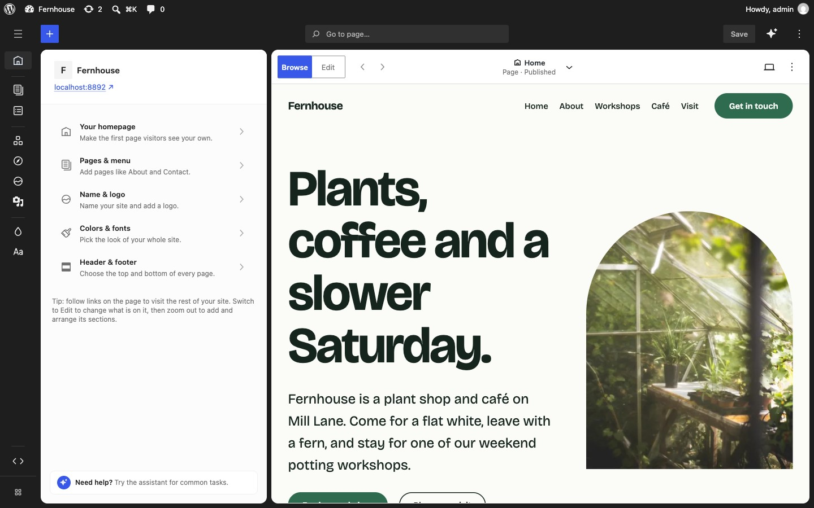

# Create Not Learn Editor

Create Not Learn is an experimental WordPress plugin that reimagines the Site Editor around what people want to do, not how WordPress works. The goal is simple. Someone who has never used WordPress should be able to set up their site without needing any help.

It looks like WordPress and behaves like WordPress, because it's built from the same packages and APIs as the editor in Core. It's a place to try bigger ideas than Core can take on today and test them with real people, so the ones that work can be proposed back to Core.

> [!WARNING]
> Create Not Learn Editor is experimental software. Don't install it on a production website. It changes often, may break without notice and hasn't been through the reviews a released plugin would get. Try it in the Playground demos below, or on a local or staging site you don't mind losing.

## Try it yourself

 

### Other demos

Each demo runs the latest build in your browser, with nothing to install.

- [Blank website](https://playground.wordpress.net/?blueprint-url=https://raw.githubusercontent.com/Automattic/create-not-learn-editor/trunk/demos/blueprint-blank.json) - default theme, no content
- [E-commerce site](https://playground.wordpress.net/?blueprint-url=https://raw.githubusercontent.com/Automattic/create-not-learn-editor/trunk/demos/blueprint-shop.json) - may take a minute or two longer to load
- Workspace demos
  - [Writing](https://playground.wordpress.net/?blueprint-url=https://raw.githubusercontent.com/Automattic/create-not-learn-editor/trunk/demos/blueprint.json&url=%2Fwp-admin%2Fadmin.php%3Fpage%3Dcreate-not-learn-editor%26workspace%3Dwriting)
  - [Builder](https://playground.wordpress.net/?blueprint-url=https://raw.githubusercontent.com/Automattic/create-not-learn-editor/trunk/demos/blueprint.json&url=%2Fwp-admin%2Fadmin.php%3Fpage%3Dcreate-not-learn-editor%26workspace%3Dbuilder)
  - [Selling](https://playground.wordpress.net/?blueprint-url=https://raw.githubusercontent.com/Automattic/create-not-learn-editor/trunk/demos/blueprint-shop.json&url=%2Fwp-admin%2Fadmin.php%3Fpage%3Dcreate-not-learn-editor%26workspace%3Dselling)

To install it on a test site, use the zip from the [latest release](https://github.com/Automattic/create-not-learn-editor/releases/latest). It needs WordPress 7.0, PHP 7.4 and Gutenberg 24.0.0 or newer.

## What problems is it trying to solve?

The project has two goals.

- Make the Site Editor far more approachable the first time someone uses it.
- Find answers to the hard problems the editor faces today.

Those hard problems include

- finding and editing what's on the homepage
- understanding the difference between pages and templates
- managing menus easily
- finding and editing the parts every page shares, like the header and footer
- building pages from sections instead of individual blocks
- knowing what a change will affect before you make it
- not having to keep moving between the editor and WP Admin
- the pull between WordPress as a blogging platform and WordPress as a page builder
- giving common goals an editing space suited to them
- being ready for editing with AI agents

## Why is this a plugin and not part of Core?

A better editor won't come from small changes alone. It needs some bigger swings, with room to experiment and test new ideas with real users.

A plugin makes that possible, because it

- is low risk
- can move quickly, using AI-powered engineering
- gets every idea checked with real people
- isn't held back by the processes that rightly govern changes to Core

This editor isn't the answer and it isn't finished. It's a vision of where the editor could go next. The ideas that hold up in testing are the ones that will be proposed for Core.

The exact route back to Core is still being worked out, but improving Core is the whole point. This is not going to become another editor fork.

### What does "Core Adjacent" mean?

The editor is Core Adjacent, which means it

- uses the WordPress Design System for its components and design
- is built from released `@wordpress/*` packages and WordPress Core APIs, on top of the released Gutenberg plugin, with no fork of Gutenberg
- follows the WordPress way, so it stays backwards compatible, can be switched off safely and never changes your site unless you ask it to

So it should feel familiar to anyone who knows WordPress, while staying easy for someone using it for the first time. [Architecture](docs/architecture.md) explains how that works in practice.

## The principles behind it

### Optimise for new users

The first screen should make sense to someone meeting WordPress for the first time. An editor that's approachable for newcomers is better for everyone.

### Use the words people use, not WordPress concepts

Labels describe what people came to do, based on user research at Automattic.

- Edit the header and footer from Home, not through template parts.
- Menus are called Menus, not Navigation.
- Pages are built from sections, with "Add section" rather than patterns.

Templates, patterns and the other system-level tools are still there, under Advanced.

### Reveal complexity when it's asked for

Every screen starts simple and shows more on demand. Page editing starts with sections, and the full block tree and tools are one step deeper in the toolbar. That's some deliberate friction, in return for a calmer first experience.

### One objective, many routes

People don't follow one path when they build a site, so the editor offers several routes to each task. The header menu can be edited

- on the canvas
- from Pages & menu
- from the Menus screen
- from Home, then Header

Blocks aren't always the right tool either. Common tasks get focused, Customizer-like screens, like adding pages and links to a menu in a familiar tree.

### One default, many modes

One interface can't serve bloggers, site builders and shops equally well. Workspaces adapt the editor to what someone came to do.

- **Default** for building a site
- **Writing** for bloggers
- **Selling** for shops, when WooCommerce is active
- **Builder** for agencies, developers and theme authors
- **Agent** for letting an agent do the work on the canvas

None of them is finished yet.

### Keep public content in the editor

Posts, pages and other public post types all live under Content, so there's no jumping back to WP Admin to manage them.

### Make room for plugins

Plugins can register their own screens in the sidebar, and their public post types appear under Content. That gives plugins such as WooCommerce room for a focused experience, without adding to the clutter in WP Admin.

### Show everything, with clear scope

The header and footer stay on the canvas while you edit a page, so you see it the way visitors do. Changes that reach every page, like the header, menu, colours and fonts, are marked as site-wide.

## Built for an agent-ready WordPress

This editor is being designed for a future where WordPress is fully AI enabled. In that future the editor is a canvas, and your own agent, whether that's Claude Code, ChatGPT or something else, uses it to show its work on your actual website.

Testing keeps showing two things, though.

- Even when an agent does most of the work, people still want to make small changes themselves.
- There's never one kind of user. Some people will want to chat, some will mix chatting with editing, some will do it all by hand and some can't or won't use AI at all.

So the editing tools have to be great on their own.

The editor already has an Agent workspace and tools for an agent in the browser to work with, so you can watch it change your site and step in at any point. [Driving the editor with WebMCP](docs/webmcp.md) explains how to connect one.

## Contributing

Ideas, bug reports and pull requests are all welcome. If something worked for you, didn't work, or you think something's missing, [open an issue](https://github.com/Automattic/create-not-learn-editor/issues).

To work on the code, start with [CONTRIBUTING.md](CONTRIBUTING.md). It covers setting up a development copy, building and checking your changes, and links to the [docs](docs/) on how the editor works.
